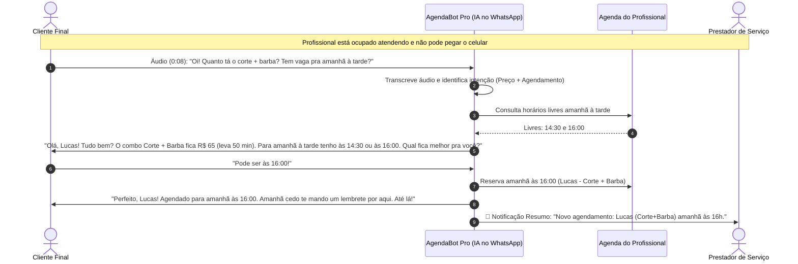

# Entregável 2 (Parte A): Canvas de Produto, Demonstração Visual e Formulário do Experimento

**Projeto:** AgendaBot Pro — Triagem e Agendamento Inteligente no WhatsApp  

---

## 1. Lean Canvas do Produto

| Bloco do Lean Canvas | Descrição Aplicada ao AgendaBot Pro |
| :--- | :--- |
| **1. Problema** | 1. Prestadores de serviço demoram horas para responder clientes no WhatsApp enquanto estão atendendo.<br>2. Perda de orçamentos e agendamentos para concorrentes mais rápidos.<br>3. Clientes odeiam robôs de menu numérico (*"Digite 1"*) e ignoram links externos de agendamento.<br>4. Alta taxa de faltas (*no-show*) por ausência de confirmação prévia. |
| **2. Segmentos de Clientes** | **Público geral:** Pequenos negócios locais e autônomos com hora marcada.<br>**Early Adopters:** Barbeiros, clínicas de estética/manicures, dentistas/fisioterapeutas autônomos e personal trainers que atendem sozinhos e recebem +15 mensagens/dia. |
| **3. Proposta de Valor Única (PUV)** | *"Sua secretária com IA no WhatsApp que atende em 5 segundos, ouve áudios, tira dúvidas e agenda seus clientes enquanto você trabalha — sem parecer um robô."* |
| **4. Solução (MVP)** | 1. Assistente de IA conversacional integrado ao WhatsApp.<br>2. Triagem automática (identifica serviço, preço e urgência).<br>3. Sincronização direta com Google Agenda e lembrete anti-falta 24h antes.<br>4. Resumo diário/notificação para o profissional + botão de "Assumir conversa". |
| **5. Canais** | • Prospecção direta via WhatsApp e Instagram de autônomos locais;<br>• Parcerias com fornecedores de insumos (cosméticos, equipamentos);<br>• Indicação boca a boca entre profissionais da mesma categoria. |
| **6. Fontes de Receita** | • Assinatura mensal (SaaS): Plano Essencial R$ 69/mês (até 300 atendimentos/mês) e Plano Pro R$ 97/mês (ilimitado + áudio + lembretes anti-falta).<br>• Teste gratuito de 7 dias. |
| **7. Estrutura de Custos** | • Consumo de tokens de LLM (API de IA generativa e transcrição de áudio);<br>• Infraestrutura de conexão com WhatsApp / nuvem;<br>• Suporte de onboarding inicial. |
| **8. Métricas-Chave** | • Tempo médio de 1ª resposta (< 10 segundos);<br>• Taxa de conversão de conversa iniciada $\rightarrow$ agendamento confirmado;<br>• Horas economizadas por semana pelo profissional;<br>• Redução percentual de *no-show* (faltas). |
| **9. Vantagem Injusta** | • Configuração por conversa em 5 minutos (o próprio profissional manda um áudio explicando seus preços e regras e a IA cria o perfil sozinha, sem precisar programar fluxos). |

---

## 2. Value Proposition Canvas (Canvas da Proposta de Valor)

### Perfil do Cliente (Prestador de Serviço Autônomo)
* **Tarefas do Cliente (Jobs to be Done):**
  * Executar seu serviço técnico com excelência e atenção total ao cliente presente;
  * Responder novos interessados, passar orçamentos e encaixar horários na agenda;
  * Confirmar se os clientes do dia seguinte realmente virão.
* **Dores (Pains):**
  * Ansiedade ao ver o celular vibrando com 20 mensagens não lidas enquanto está com as mãos ocupadas;
  * Responder clientes às 22h quando o cliente já fechou com outro;
  * Medo de colocar um chatbot tradicional e o cliente se irritar achando o atendimento frio e engessado;
  * Tomar "bolo" (*no-show*) em horários nobres (sexta e sábado).
* **Ganhos Desejados (Gains):**
  * Terminar o expediente com a agenda do dia seguinte cheia e zero mensagens pendentes;
  * Passar imagem de negócio organizado e profissional;
  * Ter controle total para intervir na conversa quando for um caso especial ou cliente VIP.

### Mapa de Valor (AgendaBot Pro)
* **Produtos e Serviços:** Assistente de IA no WhatsApp + Sincronização de Agenda + Lembrete Automático 24h antes.
* **Aliviadores de Dor (Pain Relievers):**
  * Responde em segundos de forma humanizada (inclusive entendendo áudios curtos dos clientes);
  * Não obriga o cliente a clicar em links nem baixar aplicativos;
  * Possui **"Transbordo Inteligente"**: se o cliente fizer uma pergunta complexa ou pedir desconto especial, a IA avisa o profissional e pausa a automação naquela conversa.
* **Criadores de Ganho (Gain Creators):**
  * Recupera clientes que desistiriam pela demora (basta 1 ou 2 agendamentos salvos no mês para pagar a assinatura);
  * Envia confirmação automática 24h antes e, se o cliente cancelar, libera o horário imediatamente para outro.

---

## 3. Demonstração Visual da Solução (Material para Mostrar aos 5 Usuários)

> **Como usar na entrevista/formulário:** Antes de fazer as perguntas do Bloco 2 do formulário, mostre ao profissional entrevistado o fluxograma e a simulação visual abaixo (você pode mostrar na tela ou enviar como imagem/texto no WhatsApp).

### 3.1 Fluxo Visual de Funcionamento



### 3.2 Tela Simulada de WhatsApp (Visão do Cliente vs. Visão do Profissional)

```text
=======================================================================
📱 VISÃO DO WHATSAPP (O QUE ACONTECE ENQUANTO VOCÊ ESTÁ ATENDENDO)
=======================================================================

[14:12] 👤 Cliente (Camila):
        🎤 Áudio (0:11): "Oi tudo bem? Queria saber o valor da limpeza de
        pele e se você tem algum horário livre nessa sexta depois das 15h?"

[14:12] 🤖 AgendaBot Pro (respondendo em 6 segundos no seu WhatsApp):
        "Oi, Camila! Tudo ótimo por aqui 😊
        A nossa Limpeza de Pele Profunda custa R$ 130 e dura cerca de 1h.
        Olhei na agenda desta sexta-feira e tenho dois horários após as 15h:
        • 15:30
        • 17:00
        Algum desses fica bom para você?"

[14:14] 👤 Cliente (Camila):
        "Quero o das 17:00! Aceita cartão?"

[14:14] 🤖 AgendaBot Pro:
        "Aceitamos cartão (crédito/débito) e Pix sim! ✅
        Prontinho, Camila: deixei reservado para você nesta sexta às 17:00.
        Na quinta-feira te mando uma mensagem rápida só para confirmar sua
        presença, combinado? Qualquer dúvida é só chamar!"

-----------------------------------------------------------------------
🔔 RESUMO QUE CHEGA PARA VOCÊ (PROFISSIONAL):
"✅ Novo Agendamento Automático:
• Cliente: Camila
• Serviço: Limpeza de Pele Profunda (R$ 130)
• Data/Hora: Sexta-feira às 17:00
[Ver na Agenda]  |  [Pausar IA nesta conversa]"
=======================================================================
```

---

## 4. Formulário Estruturado de Validação (Pronto para Aplicar com os 5 Usuários)

Você pode copiar as perguntas abaixo para o **Google Forms** ou aplicá-las diretamente via **WhatsApp / conversa presencial** com 5 profissionais reais durante a semana:

---

### 📋 Roteiro / Formulário de Pesquisa de Validação (5 a 7 minutos)

**Cabeçalho do Formulário:**
> *Olá! Estou realizando um estudo prático da faculdade sobre rotina de atendimento no WhatsApp para profissionais e pequenos negócios. Não estou vendendo nada — quero apenas entender como funciona o seu dia a dia e ouvir sua opinião sincera sobre uma ideia. Leva menos de 4 minutos!*

#### BLOCO 1: Perfil e Comportamento Atual (Validação do Problema)
1. **Qual é a sua atividade/profissão principal?** *(Ex.: Barbeiro, Manicure, Dentista, Personal, Técnico, etc.)*
2. **Em média, quantas mensagens de clientes (dúvidas, orçamentos ou agendamentos) você recebe por dia no WhatsApp?**
   - ( ) Menos de 5 por dia
   - ( ) Entre 5 e 15 por dia
   - ( ) Entre 16 e 30 por dia
   - ( ) Mais de 30 por dia
3. **Quando você está ocupado atendendo um cliente, quanto tempo em média uma mensagem nova demora para ser respondida?**
   - ( ) Menos de 15 minutos (paro o atendimento para responder)
   - ( ) Entre 30 minutos e 1 hora
   - ( ) Entre 1 e 3 horas
   - ( ) Só consigo responder no fim do dia / à noite
4. **Nos últimos 30 dias, você sente que deixou de fechar algum atendimento ou orçamento porque demorou para responder no WhatsApp?**
   - ( ) Sim, acontece toda semana
   - ( ) Sim, aconteceu algumas vezes no mês
   - ( ) Raramente ou nunca acontece
5. **Hoje, qual é a parte mais cansativa ou frustrante de atender clientes pelo WhatsApp?** *(Pergunta aberta)*

#### BLOCO 2: Reação à Demonstração Visual (Validação da Solução)
*(Apresente a imagem/texto da Demonstração Visual da Seção 3 acima antes das próximas perguntas)*

6. **Olhando essa demonstração do AgendaBot Pro (uma IA que responde dúvidas, ouve áudios e agenda horários direto na conversa do WhatsApp), de 1 a 5, o quanto isso ajudaria na sua rotina real?**
   - Escala de `1` (Não ajudaria nada) a `5` (Resolveria um grande problema meu)
7. **Qual seria o seu MAIOR receio ou medo em deixar uma Inteligência Artificial responder seus clientes no WhatsApp?**
   - ( ) Medo de a IA responder algo errado ou inventar informações
   - ( ) Medo de o cliente perceber que é robô e achar o atendimento frio
   - ( ) Medo de bagunçar minha agenda / marcar horário que eu não posso
   - ( ) Medo de ser difícil de configurar e mexer
   - ( ) Outro: ___________
8. **Qual dessas funcionalidades seria a MAIS importante para você confiar na ferramenta?**
   - ( ) Responder preços e dúvidas básicas na hora
   - ( ) Agendar automaticamente nos meus horários livres
   - ( ) Modo "Aprovação Rápida" (a IA faz a triagem, mas pede meu OK com 1 clique antes de cravar o horário)
   - ( ) Mandar lembrete automático 24h antes para evitar que o cliente falte (*no-show*)

#### BLOCO 3: Valor Percebido e Comprometimento (Validação de Valor / Smoke Test)
9. **Se essa ferramenta economizasse 1 hora do seu dia e recuperasse pelo menos 2 ou 3 clientes por mês que você perderia pela demora, qual valor mensal faria sentido para o seu bolso?**
   - ( ) Não pagaria por essa ferramenta (prefiro responder manualmente)
   - ( ) Até R$ 39/mês
   - ( ) Entre R$ 49 e R$ 79/mês
   - ( ) Até R$ 97/mês ou mais
10. **Teste Piloto (Comprometimento Real):** Estamos selecionando 5 profissionais para testar gratuitamente uma versão experimental por 7 dias. Você gostaria de participar? Se sim, deixe seu nome e WhatsApp/e-mail:
    - ( ) Sim! Meu contato é: _______________________
    - ( ) Agora não tenho interesse.
