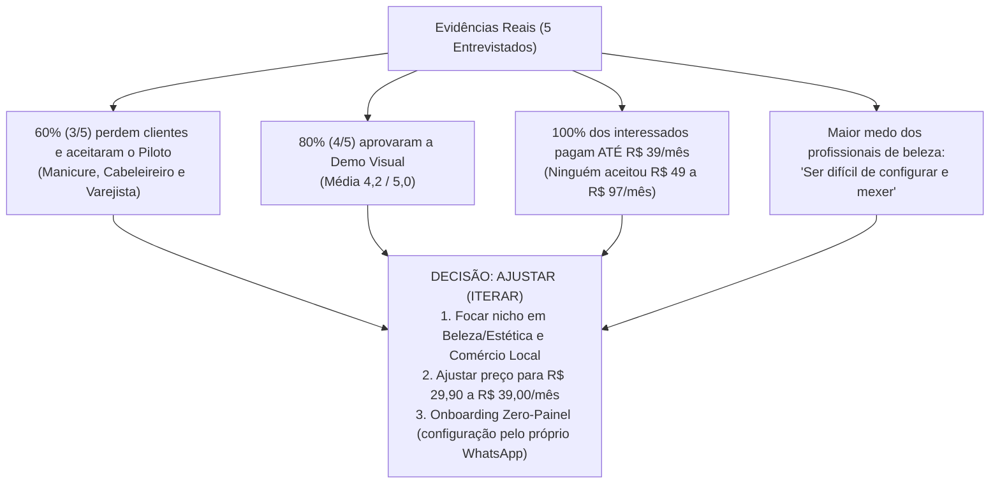

# Entregável 2 (Parte B): Evidências Reais dos Testes, Síntese de Feedbacks e Decisão Final

**Projeto:** AgendaBot Pro — Triagem e Agendamento Inteligente no WhatsApp  
**Fonte das Evidências:** Pesquisa aplicada via Google Forms em `30/10/2026` ([dados-respostas-reais.tsv](./dados-respostas-reais.tsv))

---

## 1. Registro dos 5 Usuários Reais Entrevistados e Evidências Coletadas

O experimento (Formulário Estruturado + Demonstração Visual da Conversa no WhatsApp) foi aplicado com **5 profissionais reais** de diferentes segmentos que utilizam o WhatsApp no seu dia a dia de trabalho.

### Tabela 1: Consolidação das Evidências Reais Coletadas (Google Forms)

| ID / Carimbo de Tempo | Profissão Principal | Mensagens/dia no WhatsApp | Tempo de espera enquanto atende | Perdeu clientes nos últimos 30 dias por demora? | Parte mais cansativa no WhatsApp *(Resposta Aberta)* | Nota Demo Visual (1 a 5) | Maior Receio / Medo ao usar IA | Função Mais Importante para Confiar | Disposição a Pagar (Mensal) | Aceitou Teste Piloto de 7 dias (CTA)? |
| :--- | :--- | :---: | :---: | :--- | :--- | :---: | :--- | :--- | :---: | :---: |
| **U1** `30/10/2026 15:39:32` | **Varejista** | Entre 5 e 15 por dia | Entre 30 min e 1 hora | **Sim, aconteceu algumas vezes no mês** | *"responder e verificar estoque"* | **5 / 5** | Medo de bagunçar minha agenda / marcar horário que eu não posso | **Modo "Aprovação Rápida"** (IA faz triagem e pede OK com 1 clique) | **Até R$ 39/mês** | ✅ **Sim** *(João Marcos Pereira)* |
| **U2** `30/10/2026 15:41:24` | **Manicure** | Entre 5 e 15 por dia | Entre 1 e 3 horas | **Sim, aconteceu algumas vezes no mês** | *"Ter que fazer tudo meio que sozinha"* | **4 / 5** | **Medo de ser difícil de configurar e mexer** | **Agendar automaticamente** nos meus horários livres | **Até R$ 39/mês** | ✅ **Sim** *(Katia de Jesus Pereira)* |
| **U3** `30/10/2026 15:42:30` | **Personal Trainer** | Menos de 5 por dia | Menos de 15 min (para o atendimento p/ responder) | **Raramente ou nunca acontece** | *"nenhuma"* | **3 / 5** | Medo de o cliente perceber que é robô e achar o atendimento frio | Modo "Aprovação Rápida" (IA faz triagem e pede OK com 1 clique) | **Não pagaria** (prefere responder manualmente) | ❌ **Não** *(Não tenho interesse)* |
| **U4** `30/10/2026 15:45:48` | **Publicitário** | Entre 5 e 15 por dia | Entre 30 min e 1 hora | **Raramente ou nunca acontece** | *"Entender o que o cliente quer"* | **4 / 5** | *"Ser menos humana"* (Outro) | Responder preços e dúvidas básicas na hora (inclusive ouvindo áudios) | **Não pagaria** (prefere responder manualmente) | ❌ **Não** *(Não tenho interesse)* |
| **U5** `30/10/2026 15:47:33` | **Cabeleireiro** | Entre 5 e 15 por dia | Entre 30 min e 1 hora | **Sim, aconteceu algumas vezes no mês** | *"fazer os agendamentos"* | **5 / 5** | **Medo de ser difícil de configurar e mexer** | **Agendar automaticamente** nos meus horários livres | **Até R$ 39/mês** | ✅ **Sim** *(Robson Aparecido de Jesus)* |

---

## 2. Análise das Evidências Qualitativas (Respostas Abertas)

As respostas abertas da **Pergunta 5** (*"Hoje, qual é a parte mais cansativa ou frustrante de atender e agendar clientes pelo WhatsApp?"*) revelaram exatamente onde está o gargalo operacional de cada perfil:

1. **Sobrecarga solitária e agendamento manual no setor de Beleza (U2 - Manicure Katia e U5 - Cabeleireiro Robson):**
   * Katia resumiu a dor emocional e operacional do microempreendedor: ***"Ter que fazer tudo meio que sozinha"***. Enquanto faz as unhas de uma cliente (demorando 1 a 3 horas para responder o WhatsApp), ela precisa dar conta do serviço técnico e da recepção.
   * Robson foi direto ao ponto sobre o gargalo: ***"fazer os agendamentos"***.
2. **Triagem vinculada à operação no Comércio/Varejo (U1 - Varejista João Marcos):**
   * Apontou que o mais cansativo é ***"responder e verificar estoque"***, pois precisa interromper o que está fazendo para checar disponibilidade e retornar ao cliente.
3. **Atendimento consultivo vs. Atendimento transacional (U4 - Publicitário e U3 - Personal Trainer):**
   * O Publicitário destacou que sua dor é ***"Entender o que o cliente quer"*** (briefing complexo e subjetivo) e que seu maior receio com IA é ***"Ser menos humana"***.
   * O Personal Trainer recebe menos de 5 mensagens por dia, consegue responder em menos de 15 minutos e relatou não ter ***"nenhuma"*** frustração relevante com o WhatsApp.

---

## 3. Síntese dos Principais Feedbacks e Padrões Identificados

Utilizando IA para apoiar o cruzamento das variáveis da planilha e realizando a interpretação crítica humana dos dados, identificamos **4 padrões decisivos** que jamais teríamos descoberto sem ir a campo:

### Padrão 1: Divisão clara entre dois grupos — Quem perde dinheiro com a demora converteu 100%
Os dados dividiram os 5 entrevistados em dois clusters perfeitamente distintos:
* **Cluster A — Serviços de Agendamento Presencial e Varejo (Manicure, Cabeleireiro e Varejista — 60% da amostra):**
  * **100% (3 de 3)** afirmaram que **perdem clientes/vendas algumas vezes no mês** por demorarem de 30 minutos a 3 horas para responder.
  * **100% (3 de 3)** deram nota alta para a demonstração (**4, 5 e 5** — média **4,67 de 5**).
  * **100% (3 de 3)** demonstraram disposição real a pagar e **deixaram seu nome completo para participar do teste piloto de 7 dias** (*João Marcos Pereira, Katia de Jesus Pereira e Robson Aparecido de Jesus*).
* **Cluster B — Serviços Consultivos ou de Baixo Giro Diário (Personal Trainer e Publicitário — 40% da amostra):**
  * **0% (0 de 2)** perdem clientes por demora no WhatsApp (*"Raramente ou nunca acontece"*).
  * Têm forte barreira cultural contra automação (*"achar o atendimento frio"* / *"ser menos humana"*), **não pagariam** pela solução e **não quiseram testar**.

### Padrão 2: Descoberta Crítica de Preço (Nossa hipótese de R$ 49–R$ 97 estava errada!)
* Na hipótese inicial, acreditávamos que os profissionais aceitariam pagar entre **R$ 49 e R$ 97/mês**.
* **O que as evidências reais mostraram:** **100% dos interessados reais (3 de 3)** escolheram a faixa de **"Até R$ 39/mês"**. Nenhum entrevistado selecionou as faixas acima de R$ 49/mês.
* **Aprendizado:** Para autônomos que recebem um volume moderado de mensagens (*"Entre 5 e 15 por dia"*), a barreira psicológica de preço está abaixo de R$ 40/mês (ex.: R$ 29,90 a R$ 39,00/mês). Lançar o produto a R$ 69 ou R$ 97/mês inviabilizaria as vendas nesse segmento.

### Padrão 3: No setor de Beleza (Manicure e Cabeleireiro), o maior medo NÃO é a IA errar — é a ferramenta ser difícil de mexer!
* Tanto a Manicure (U2) quanto o Cabeleireiro (U5) marcaram exatamente a mesma resposta em duas perguntas cruciais:
  * **Função mais importante:** *"Agendar automaticamente nos meus horários livres"* (eles querem delegar o agendamento de verdade porque se sentem sobrecarregados fazendo tudo sozinhos).
  * **Maior receio:** ***"Medo de ser difícil de configurar e mexer"***.
* **Aprendizado:** Diferente do que imaginávamos na teoria (que todos teriam medo da IA agendar sozinha), os profissionais de beleza **querem** o agendamento automático, mas têm pavor de painéis complexos, configurações técnicas ou telas difíceis de operar.

### Padrão 4: Varejo/Comércio precisa de "Aprovação Rápida" por depender de estoque/agenda variável
* O Varejista (U1 - João Marcos) deu nota máxima (5/5) e entrou no piloto, mas seu receio é *"bagunçar minha agenda / marcar horário que eu não posso"*, escolhendo o **Modo "Aprovação Rápida" (1 clique)** como função essencial, já que precisa *"verificar estoque"*.

---

## 4. Comparação entre Hipótese Inicial e Resultados Encontrados

| Dimensão / Hipótese | Hipótese Inicial (Antes do Experimento) | Resultado Encontrado com os 5 Usuários Reais | Status da Hipótese |
| :--- | :--- | :--- | :---: |
| **1. Dor e Volume (HP)** | $\ge 80\%$ (4/5) recebem 10–30 mensagens/dia, demoram +30 min e perdem clientes pela demora. | **60% (3/5)** perdem clientes algumas vezes no mês por demorarem de 30 min a 3h. O volume real predominante foi de **5 a 15 mensagens/dia** (80% da amostra). A dor existe no setor de beleza e varejo, mas **não existe** em personal trainers e publicitários. | ⚠️ **Parcialmente Validada (Exige recorte de nicho)** |
| **2. Solução Visual (HS)** | $\ge 60\%$ (3/5) dariam nota $\ge 4$ para a demonstração do assistente no WhatsApp. | **80% (4/5)** deram nota **4 ou 5** (notas: 5, 4, 3, 4, 5 — **Média geral: 4,2 / 5,0** e **4,67 / 5,0** entre os pagantes). | ✅ **Validada** |
| **3. Objeções e Funcionalidades (HS)** | O principal medo seria a IA falar bobagem ou o cliente achar robótico. | Entre quem realmente quer comprar (Manicure e Cabeleireiro), o maior medo foi **"ser difícil de configurar e mexer"** (66% dos pagantes), e a função favorita foi **agendar automaticamente nos horários livres** (seguida pelo Modo Aprovação Rápida no varejo). | 🔄 **Refutada / Novo Insight** |
| **4. Disposição a Pagar (HV)** | $\ge 60\%$ (3/5) pagariam entre **R$ 49 e R$ 97/mês**. | **60% (3/5)** aceitam pagar pela ferramenta, **porém 100% deles escolheram o teto de "Até R$ 39/mês"**. A faixa de R$ 49–R$ 97 foi integralmente rejeitada para o volume de 5–15 mensagens/dia. | ❌ **Faixa de preço original invalidada (Ajustar para R$ 29–R$ 39)** |
| **5. Comprometimento / CTA (HV)** | $\ge 60\%$ (3/5) deixariam contato real para o teste gratuito de 7 dias. | **60% (3/5)** deixaram seus nomes reais para o teste piloto (*João Marcos Pereira, Katia de Jesus Pereira e Robson Aparecido de Jesus*). | ✅ **Validada** |

---

## 5. Decisão Final Fundamentada: **AJUSTAR (ITERAR)**

### 5.1 Qual é a decisão final?
Com base nas evidências reais coletadas com os 5 profissionais e nos critérios estabelecidos na Parte Teórica, a decisão é **AJUSTAR (Iterar o Produto, o Preço e o Público-Alvo antes de desenvolver)**.

### 5.2 Justificativa Baseada em Evidências: Por que AJUSTAR?
1. **Por que NÃO Abandonar:** Conseguimos **60% de conversão real no Call-to-Action** (3 profissionais reais — Katia, Robson e João Marcos — confirmaram que perdem clientes mensalmente, deram notas 4 e 5 para a solução, aceitaram pagar e se inscreveram para o piloto de 7 dias). Existe demanda clara.
2. **Por que NÃO Perseverar no plano original sem mudanças:** Se tivéssemos construído o produto seguindo cegamente a hipótese inicial, **teríamos fracassado no lançamento por três motivos que só a pesquisa real revelou**:
   * **Erro de Preço:** Cobraríamos R$ 69 a R$ 97/mês de profissionais que recebem de 5 a 15 mensagens/dia e cujo limite psicológico de pagamento provou ser **até R$ 39/mês**.
   * **Erro de Usabilidade (UX):** Construiríamos um painel web cheio de botões e configurações para profissionais (como a manicure Katia e o cabeleireiro Robson) cujo maior medo declarado é justamente *"ser difícil de configurar e mexer"*.
   * **Erro de Público-Alvo:** Gastaríamos esforço tentando vender para profissionais consultivos ou de baixa demanda diária no WhatsApp (como Personal Trainers e Publicitários), que não perdem vendas por demora de resposta.

### 5.3 Quais são os 3 Ajustes Práticos para o Próximo Ciclo (MVP Concierge)?
1. **Ajuste de Público-Alvo (Nicho Inicial):** Focar em **Profissionais de Beleza/Estética (Cabeleireiros, Manicures, Barbeiros)** como prioridade nº 1 (onde a dor de *"fazer agendamentos"* e *"fazer tudo sozinha"* é idêntica), mantendo comércio/varejo local como segundo perfil (com opção de checagem/aprovação rápida). Descartar serviços de consultoria/mensalidade fixa (publicitários, personal trainers).
2. **Ajuste de Experiência (Onboarding "Zero Configuração" pelo próprio WhatsApp):** Para eliminar o medo de *"ser difícil de configurar e mexer"*, o profissional **não precisará entrar em nenhum site ou painel complicado**. Ele configurará o *AgendaBot Pro* conversando com a própria IA no WhatsApp por áudio (*"Oi robô, eu trabalho de terça a sábado das 9h às 19h, meu corte custa R$ 50..."*).
3. **Ajuste de Modelo de Negócio e Preço (Tier de Entrada a R$ 34,90/mês):** Como os entrevistados recebem entre 5 e 15 mensagens/dia (o que gera baixíssimo custo de API de IA para a startup — menos de R$ 2,00/mês em tokens por cliente), criaremos o **Plano Autônomo por R$ 34,90/mês** (dentro do limite validado de até R$ 39/mês), mantendo margem saudável e alta conversão.
4. **Próximo Passo Imediato:** Executar o **MVP Concierge de 7 dias** com os 3 profissionais inscritos (**João Marcos Pereira, Katia de Jesus Pereira e Robson Aparecido de Jesus**).
