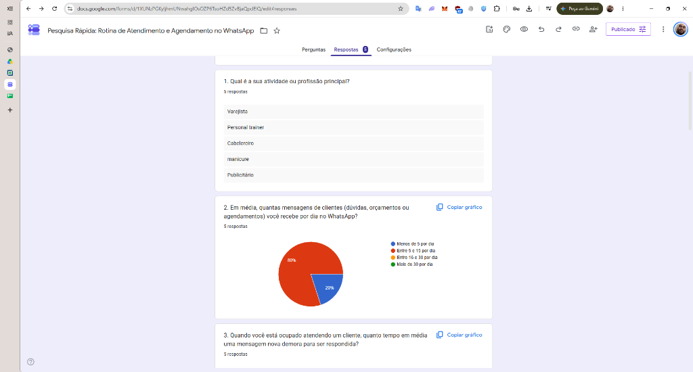
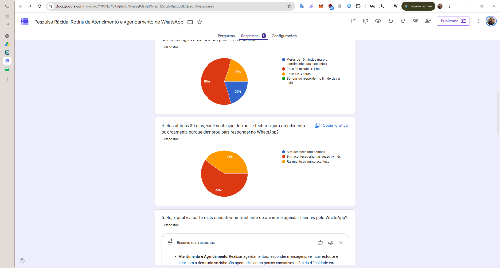
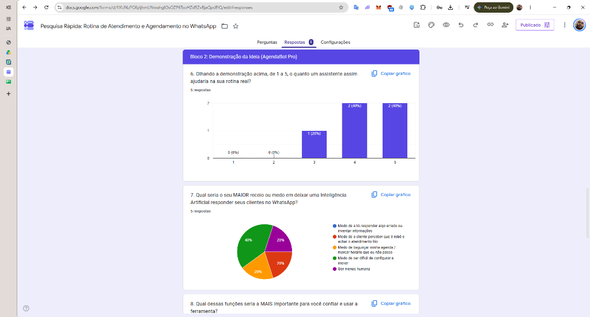
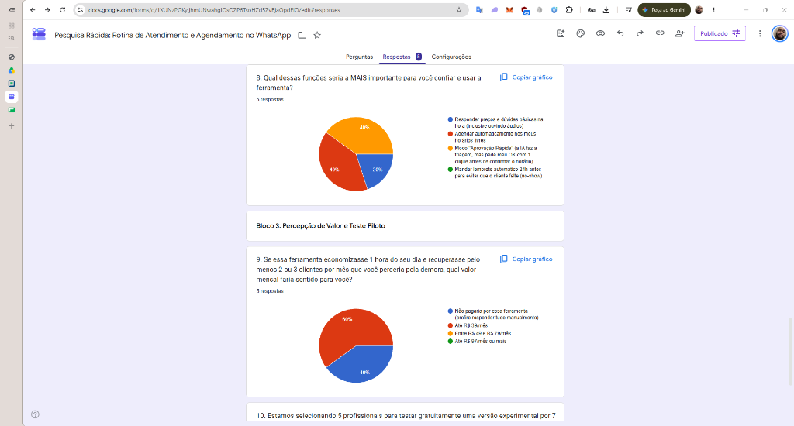
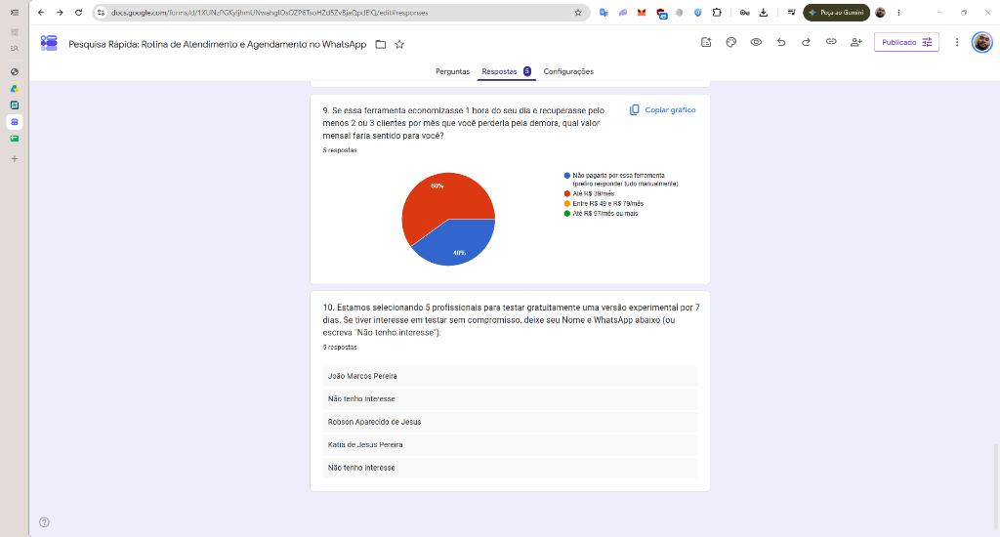

# Da Hipótese à Evidência: Validando um Produto Digital com IA e Métodos Ágeis

**Projeto / Case:** AgendaBot Pro — Triagem e Agendamento Inteligente no WhatsApp  
**Disciplina:** Metodologias Ágeis e Validação de Produtos (Rocketseat / FTR)  
**Data da Validação Real:** 30/10/2026  
**Link do Vídeo Pitch (Entregável 3 - até 4 min):** `[INSIRA AQUI O SEU LINK DO YOUTUBE / LOOM / GOOGLE DRIVE]`

---

# ENTREGÁVEL 1: Parte Teórica – Hipóteses e Estratégia de Validação

## 1. Problema Identificado, Público e Oportunidade

### 1.1 O Problema Real
Profissionais autônomos e pequenos negócios locais utilizam o WhatsApp como principal canal de atendimento, orçamento e agendamento. Contudo, **enquanto estão executando o serviço técnico** (fazendo unhas, cortando cabelo, atendendo no balcão ou realizando procedimentos), eles ficam com as mãos ocupadas e **demoram de 30 minutos a 3 horas para responder mensagens novas**.

Essa demora gera três consequências diretas:
1. **Perda de clientes e vendas (Leads frios):** Clientes que precisam de horário ou resposta rápida fecham com o concorrente que respondeu primeiro.
2. **Sobrecarga operacional ("Fazer tudo sozinho"):** O profissional acumula a função técnica e a função de recepcionista/atendente, gerando exaustão ao responder mensagens e organizar agenda nos intervalos ou à noite.
3. **Atrito com soluções atuais:** Chatbots tradicionais baseados em menus numéricos (*"Digite 1 para agendar, 2 para valores"*) irritam os clientes por parecerem engessados, travam quando recebem áudio e exigem que o cliente clique em links externos de agendamento que raramente são preenchidos.

### 1.2 Público-Alvo e Early Adopters
* **Público-Alvo Investigado:** Microempreendedores individuais (MEIs), prestadores de serviço com hora marcada e pequenos varejistas locais que dependem do WhatsApp diariamente.
* **Perfil de Early Adopter:** Profissionais que trabalham sozinhos (sem secretária dedicada), recebem entre **5 e 30 mensagens diárias no WhatsApp** e sofrem interrupções constantes durante o expediente.

### 1.3 A Oportunidade com IA e Automação Digital
Utilizar **IA Generativa combinada com Automação de Agenda** diretamente no WhatsApp para atuar como uma recepcionista virtual natural: capaz de transcrever e entender áudios curtos dos clientes, responder dúvidas de preços/serviços em segundos e realizar a triagem/agendamento dentro da própria conversa, sem obrigar o cliente a sair do aplicativo.

---

## 2. Hipóteses de Problema, Solução e Valor

Aplicando os princípios de *Lean Startup* (transformar suposições em hipóteses testáveis antes de construir) e o empirismo ágil (*Transparência, Inspeção e Adaptação*), estruturamos três hipóteses centrais:

### Hipótese de Problema (HP)
> **Acreditamos que** prestadores de serviço autônomos e pequenos negócios locais demoram mais de 30 minutos para responder mensagens no WhatsApp enquanto estão atendendo, e que pelo menos **60% a 80% deles deixam de fechar vendas ou agendamentos no mês** por causa dessa demora.

### Hipótese de Solução (HS)
> **Acreditamos que** uma demonstração de assistente de IA conversacional no WhatsApp (capaz de ouvir áudios, informar preços, checar disponibilidade e organizar o agendamento) terá alta aceitação (**nota $\ge 4$ em uma escala de 1 a 5** para pelo menos **60% dos entrevistados**), superando a rejeição aos bots tradicionais de menu numérico.

### Hipótese de Valor e Disposição a Pagar (HV)
> **Acreditamos que** pelo menos **60% dos profissionais entrevistados** enxergarão retorno financeiro claro na ferramenta a ponto de:
> 1. Demonstrar disposição a pagar uma assinatura mensal entre **R$ 49 e R$ 97/mês**;
> 2. Deixar seu nome/contato real (*Call-to-Action* / *Smoke Test*) para participar de um teste piloto gratuito de 7 dias na sua rotina.

---

## 3. Solução Inicialmente Proposta e Definição do MVP

### 3.1 Solução Inicialmente Proposta
O **AgendaBot Pro** foi concebido inicialmente como uma plataforma SaaS onde o profissional conecta seu WhatsApp Business e sua agenda (Google Agenda), configurando sua tabela de preços e horários para que a IA realize 100% do atendimento e agendamento de forma autônoma, enviando apenas um resumo final ao profissional.

### 3.2 Definição do MVP (Mínimo Produto Viável para Descoberta)
Como o objetivo do Product Discovery **não é desenvolver o software completo, mas descobrir se ele merece ser desenvolvido** com o menor esforço possível (*Ciclo Construir-Medir-Aprender*), definimos como MVP de validação um experimento combinado de **Teste de Conceito Visual + Smoke Test (Teste de Fumaça)**:
1. **Demonstração Visual Realista da Solução:** Simulação passo a passo de uma conversa real no WhatsApp mostrando o cliente enviando áudio, a IA respondendo em 6 segundos com preço e horários disponíveis, confirmando o agendamento e notificando o profissional.
2. **Formulário Estruturado de Validação (Google Forms):** Instrumento de 10 perguntas focado no comportamento real passado (*Mom Test*), nas barreiras de adoção da solução apresentada e na conversão real para um piloto de 7 dias.

---

## 4. Como a IA foi Utilizada Durante o Processo de Discovery

Seguindo a premissa fundamental de que **"IA não valida mercado; pessoas reais validam hipóteses"**, utilizamos Inteligência Artificial (LLMs) estritamente como **ferramenta de produtividade e apoio analítico**, mantendo 100% da coleta de campo e da tomada de decisão sob responsabilidade humana:

| Etapa do Discovery | Papel da IA como Copiloto | Papel Humano (Aluno / Produto) |
| :--- | :--- | :--- |
| **1. Estruturação de Hipóteses** | Apoio no mapeamento de dores do pequeno empreendedor e estruturação do Lean Canvas e Value Proposition Canvas. | Seleção do problema real e definição das métricas e recortes de público. |
| **2. Desenho do Experimento e Automação** | Refinamento das perguntas para evitar viés de confirmação e geração de script (*Google Apps Script*) para publicar o formulário no Google Forms. | Disparo do formulário e coleta de respostas com **5 profissionais reais** do mercado. |
| **3. Prototipação da Conversa** | Simulação do diálogo natural do *AgendaBot Pro* para compor a demonstração visual apresentada no formulário. | Avaliação de aderência da demonstração ao contexto real dos entrevistados. |
| **4. Organização e Clusterização de Dados** | Tabulação das respostas brutas do Google Forms e agrupamento de padrões entre diferentes profissões. | **Interpretação crítica dos resultados**, identificação das hipóteses refutadas (como a faixa de preço) e **decisão final de Ajustar**. |

---

## 5. Experimento Escolhido e Critérios de Sucesso

### 5.1 Estrutura do Experimento
O experimento foi dividido em **3 blocos sequenciais** aplicados a **5 potenciais usuários reais**:
* **Bloco 1 (Diagnóstico do Problema sem viés):** Profissão, volume diário de mensagens no WhatsApp, tempo médio de espera enquanto está ocupado atendendo, frequência de perda de clientes nos últimos 30 dias e pergunta aberta sobre a maior frustração atual.
* **Bloco 2 (Exposição à Demonstração Visual e Validação da Solução):** Apresentação da conversa simulada do *AgendaBot Pro* seguida de avaliação quantitativa (escala 1 a 5), mapeamento do maior medo/receio em relação à IA e escolha da funcionalidade mais importante para gerar confiança.
* **Bloco 3 (Validação de Valor, Preço e Comprometimento):** Teste de sensibilidade a preço mensal (ancorado na recuperação de 2 a 3 clientes/mês) e *Call-to-Action* (deixar Nome/Contato para participar do piloto gratuito de 7 dias — métrica acionável contra métricas de vaidade).

### 5.2 Critérios Objetivos de Sucesso
1. **Critério de Problema:** $\ge 60\%$ (mínimo 3 de 5) demoram mais de 30 minutos para responder durante atendimentos e admitem perder clientes/vendas no mês por isso.
2. **Critério de Solução:** $\ge 60\%$ (mínimo 3 de 5) avaliam a demonstração visual com nota $\ge 4$ (de 5).
3. **Critério de Valor (Preço):** $\ge 60\%$ (mínimo 3 de 5) aceitam pagar entre R$ 49 e R$ 97/mês.
4. **Critério de Comprometimento Real (CTA):** $\ge 60\%$ (mínimo 3 de 5) se inscrevem voluntariamente deixando seu nome/contato para o teste piloto de 7 dias.

---

## 6. Critério Previamente Definido para Decidir (Perseverar, Ajustar, Pivotar ou Abandonar)

| Decisão | Critério Pré-Definido (Gatilho de Evidência) | Ação Decorrente |
| :--- | :--- | :--- |
| **PERSEVERAR** | Todos os 4 critérios de sucesso ($\ge 60\%$) são atingidos sem objeções graves quanto a preço (R$ 49–97), usabilidade ou público-alvo. | Construir o MVP exatamente como planejado e iniciar os testes com os inscritos. |
| **AJUSTAR (Iterar)** | A dor real, o interesse na solução (nota $\ge 4$) e a conversão no piloto ($\ge 60\%$) são validados, **MAS** os dados revelam divergência na faixa de preço aceita, recorte específico de nicho ou barreiras de usabilidade/configuração. | Manter a visão central do produto, mas **iterar o modelo de preço, o foco de segmento ou o fluxo de configuração do MVP** antes de desenvolver. |
| **PIVOTAR** | Os profissionais confirmam a dor de tempo, mas rejeitam colocar IA para falar com seus clientes no WhatsApp (nota $< 3$), preferindo automação apenas para lembretes internos ou controle financeiro. | Mudar radicalmente a solução proposta mantendo o mesmo segmento de clientes. |
| **ABANDONAR** | Menos de 3 entrevistados ($< 60\%$) perdem vendas por demora no WhatsApp **OU** menos de 2 pessoas deixam contato para o teste piloto gratuito. | Encerrar o projeto imediatamente, evitando desperdício de tempo e capital em um produto sem demanda real. |

---
---

# ENTREGÁVEL 2: Parte Prática – Experimento Real de Validação

## 1. Canvas de Produto (Lean Canvas e Value Proposition Canvas)

### 1.1 Lean Canvas

| Bloco do Lean Canvas | Descrição do Produto (AgendaBot Pro) |
| :--- | :--- |
| **1. Problema** | 1. Prestadores de serviço e pequenos comércios demoram de 30 min a 3h para responder clientes no WhatsApp enquanto atendem.<br>2. Perda recorrente de vendas e agendamentos no mês por demora no retorno.<br>3. Sobrecarga operacional de *"ter que fazer tudo sozinho"* (atender + agendar + checar estoque).<br>4. Rejeição dos clientes a chatbots engessados de menu numérico (*"Digite 1"*). |
| **2. Segmentos de Clientes** | **Público Investigado:** Autônomos e pequenos negócios locais que atendem via WhatsApp.<br>**Early Adopters Validados:** Profissionais de Beleza/Estética (Cabeleireiros, Manicures, Barbeiros) e Pequeno Varejo Local (recebendo de 5 a 15 mensagens/dia). |
| **3. Proposta de Valor Única (PUV)** | *"Sua secretária com IA no WhatsApp que responde em 6 segundos, ouve áudios e organiza seus agendamentos enquanto você trabalha — sem precisar configurar painéis difíceis."* |
| **4. Solução (MVP)** | 1. Assistente de IA conversacional integrado ao próprio WhatsApp.<br>2. Triagem automática de dúvidas de preços, serviços e disponibilidade.<br>3. Duas modalidades de operação: **Agendamento Automático** (preferido por Beleza) ou **Modo Aprovação Rápida em 1 Clique** (preferido por Varejo).<br>4. Configuração simplificada pelo próprio WhatsApp (zero painel complexo). |
| **5. Canais** | • Abordagem direta via WhatsApp e Instagram de profissionais locais;<br>• Indicação entre profissionais do mesmo salão/galeria comercial. |
| **6. Fontes de Receita** | • Assinatura mensal enxuta (**R$ 34,90/mês** — ajustada após validação real que apontou teto de até R$ 39/mês para autônomos de 5 a 15 mensagens/dia);<br>• Teste piloto gratuito de 7 dias. |
| **7. Estrutura de Custos** | • Consumo de tokens de LLM (baixo custo: ~5 a 15 conversas/dia = menos de R$ 2,00/mês por profissional);<br>• Infraestrutura de nuvem e integração WhatsApp. |
| **8. Métricas-Chave** | • Tempo médio de 1ª resposta (< 10 segundos);<br>• Taxa de conversão no *Smoke Test* (inscritos no piloto de 7 dias);<br>• Agendamentos/vendas recuperadas por mês;<br>• Retenção após os 7 dias de teste. |
| **9. Vantagem Injusta** | • Onboarding "Zero-Painel": o profissional configura horários e preços mandando um simples áudio no WhatsApp, eliminando a barreira técnica. |

---

### 1.2 Value Proposition Canvas (Canvas da Proposta de Valor)

| Perfil do Cliente (Autônomo de Beleza / Pequeno Comércio) | Mapa de Valor (AgendaBot Pro) |
| :--- | :--- |
| **Tarefas do Cliente (Jobs to be Done):**<br>• Executar o serviço técnico (cabelo, unha, atendimento no balcão) com foco total;<br>• Responder dúvidas de preços, checar disponibilidade e marcar horários no WhatsApp. | **Produtos e Serviços:**<br>• Assistente de IA Generativa no WhatsApp;<br>• Agendamento automático nos horários livres;<br>• Modo "Aprovação Rápida" (1 clique). |
| **Dores (Pains):**<br>• *"Ter que fazer tudo meio que sozinha"* (fala real - U2);<br>• Cansaço de *"fazer os agendamentos"* (fala real - U5) e *"responder e verificar estoque"* (fala real - U1);<br>• Demorar de 30 min a 3h para responder e perder clientes no mês;<br>• **Medo de a ferramenta ser difícil de configurar e mexer** (U2 e U5) ou bagunçar a agenda (U1). | **Aliviadores de Dor (Pain Relievers):**<br>• Atende o cliente em segundos enquanto o profissional está ocupado;<br>• Configuração 100% guiada por conversa (sem sistemas difíceis de mexer);<br>• Opção de pedir OK com 1 clique antes de confirmar o horário quando depende de estoque/avaliação. |
| **Ganhos Desejados (Gains):**<br>• Não perder mais vendas/agendamentos durante o expediente;<br>• Economizar 1 hora por dia de digitação repetitiva;<br>• Mensalidade acessível que caiba no bolso do MEI (até R$ 39/mês). | **Criadores de Ganho (Gain Creators):**<br>• Basta recuperar 1 único atendimento no mês (R$ 40 a R$ 80) para pagar a assinatura de R$ 34,90/mês com lucro;<br>• Atendimento natural que entende áudios dos clientes. |

---

## 2. O Experimento Realizado (Demonstração Visual + Formulário no Google Forms)

Para testar as hipóteses sem construir o software completo, aplicamos um experimento via **Google Forms** contendo a **Demonstração Visual da Conversa no WhatsApp** seguida de **10 perguntas estruturadas**:

```text
📱 SIMULAÇÃO DE CONVERSA APRESENTADA NO FORMULÁRIO:

👤 Cliente (14:12 - Áudio de 10s):
"Oi tudo bem? Queria saber o valor do atendimento e se você tem algum horário livre nessa sexta depois das 15h?"

🤖 AgendaBot Pro (14:12 - responde em 6 segundos):
"Oi, Camila! Tudo ótimo por aqui 😊 O atendimento custa R$ 130 e dura cerca de 1h. Olhei na agenda desta sexta-feira e tenho dois horários livres após as 15h: às 15:30 ou às 17:00. Algum desses fica bom para você?"

👤 Cliente (14:14):
"Quero o das 17:00! Aceita cartão?"

🤖 AgendaBot Pro (14:14):
"Aceitamos cartão e Pix sim! ✅ Prontinho, Camila: deixei pré-reservado para você nesta sexta às 17:00. Na quinta-feira te mando um lembrete rápido por aqui para confirmar sua presença, combinado?"

🔔 O QUE CHEGA PARA VOCÊ (PROFISSIONAL):
"Resumo: Camila solicitou agendamento para Sexta às 17:00 (R$ 130). [Confirmar Horário] | [Assumir Conversa]"
```

---

## 3. Validação com 5 Potenciais Usuários Reais e Evidências Coletadas

O experimento foi respondido em **`30/10/2026`** por **5 profissionais reais**: um **Varejista**, uma **Manicure**, um **Personal Trainer**, um **Publicitário** e um **Cabeleireiro**.

| Carimbo de data/hora | 1. Profissão Principal | 2. Mensagens por dia | 3. Tempo de espera enquanto atende | 4. Deixou de fechar nos últimos 30 dias por demora? | 5. Parte mais cansativa no WhatsApp *(Fala literal)* | 6. Nota Demo (1 a 5) | 7. Maior Receio / Medo com a IA | 8. Função Mais Importante | 9. Valor Mensal que Faria Sentido | 10. Interesse no Piloto de 7 dias (CTA) |
| :--- | :--- | :---: | :---: | :--- | :--- | :---: | :--- | :--- | :---: | :--- |
| `30/10/2026 15:39:32` | **Varejista** | Entre 5 e 15 por dia | Entre 30 min e 1 hora | **Sim, aconteceu algumas vezes no mês** | *"responder e verificar estoque"* | **5** | Medo de bagunçar minha agenda / marcar horário que eu não posso | Modo "Aprovação Rápida" (IA faz triagem e pede OK com 1 clique) | **Até R$ 39/mês** | ✅ **João Marcos Pereira** |
| `30/10/2026 15:41:24` | **manicure** | Entre 5 e 15 por dia | Entre 1 e 3 horas | **Sim, aconteceu algumas vezes no mês** | *"Ter que fazer tudo meio que sozinha"* | **4** | **Medo de ser difícil de configurar e mexer** | **Agendar automaticamente nos meus horários livres** | **Até R$ 39/mês** | ✅ **Katia de Jesus Pereira** |
| `30/10/2026 15:42:30` | **Personal trainer** | Menos de 5 por dia | Menos de 15 min (paro p/ responder) | **Raramente ou nunca acontece** | *"nenhuma"* | **3** | Medo de o cliente perceber que é robô e achar o atendimento frio | Modo "Aprovação Rápida" (IA faz triagem e pede OK com 1 clique) | **Não pagaria** (prefiro responder manualmente) | ❌ *Não tenho interesse* |
| `30/10/2026 15:45:48` | **Publicitário** | Entre 5 e 15 por dia | Entre 30 min e 1 hora | **Raramente ou nunca acontece** | *"Entender o que o cliente quer"* | **4** | *"Ser menos humana"* | Responder preços e dúvidas básicas na hora (ouvindo áudios) | **Não pagaria** (prefiro responder manualmente) | ❌ *Não tenho interesse* |
| `30/10/2026 15:47:33` | **Cabelereiro** | Entre 5 e 15 por dia | Entre 30 min e 1 hora | **Sim, aconteceu algumas vezes no mês** | *"fazer os agendamentos"* | **5** | **Medo de ser difícil de configurar e mexer** | **Agendar automaticamente nos meus horários livres** | **Até R$ 39/mês** | ✅ **Robson Aparecido de Jesus** |

### 3.1 Prints Oficiais das Respostas no Google Forms (Evidências Visuais)

1. **Perguntas 1 e 2 (Profissão Principal e Volume Diário de Mensagens no WhatsApp):**
   
2. **Perguntas 3, 4 e 5 (Tempo de Espera durante Atendimento, Perda de Clientes nos últimos 30 dias e Parte mais cansativa):**
   
3. **Perguntas 6 e 7 (Nota de 1 a 5 para a Demonstração do AgendaBot Pro e Maior Receio/Medo com a IA):**
   
4. **Perguntas 8 e 9 (Função Mais Importante e Disposição a Pagar Mensalmente):**
   
5. **Perguntas 9 e 10 (Sensibilidade a Preço e Inscritos Reais no Teste Piloto de 7 Dias):**
   

---

## 4. Síntese dos Principais Feedbacks e Padrões Identificados

1. **Divisão clara de Público-Alvo (Quem sente a dor converteu 100%):**
   * **Beleza e Varejo (Manicure Katia, Cabeleireiro Robson e Varejista João Marcos — 60% da amostra):** 100% deles demoram de 30 min a 3h para responder, **perdem clientes no mês**, deram notas **4 e 5** (média **4,67/5**), aceitam pagar e **deixaram seu nome completo para o teste piloto de 7 dias**.
   * **Serviços Consultivos / Baixo Giro Diário (Personal Trainer e Publicitário — 40% da amostra):** 0% perdem vendas por demora, receiam que o atendimento fique *"frio / menos humano"*, **não pagariam** e **não têm interesse no piloto**.
2. **Descoberta Crítica de Preço (Teto unânime de R$ 39/mês):**
   * **100% dos pagantes reais (3 de 3)** escolheram **"Até R$ 39/mês"**. Ninguém aceitou a faixa planejada originalmente de R$ 49 a R$ 97/mês, pois o volume médio deles é de 5 a 15 mensagens/dia.
3. **Descoberta de Usabilidade no Setor de Beleza:**
   * Tanto a **Manicure (Katia)** quanto o **Cabeleireiro (Robson)** querem que a IA **agende automaticamente nos horários livres** (para aliviar o peso de *"fazer os agendamentos"* e *"fazer tudo meio que sozinha"*), mas ambos têm o mesmo medo principal: **"Medo de ser difícil de configurar e mexer"**.
4. **Necessidade de Controle no Varejo:**
   * O **Varejista (João Marcos)**, que precisa *"responder e verificar estoque"*, teme que a IA marque compromissos sem checagem e por isso prefere o **Modo "Aprovação Rápida" (1 clique)**.

---

## 5. Comparação entre Hipótese Inicial e Resultados Encontrados

| Hipótese Avaliada | Hipótese Inicial (Antes do Experimento) | Resultado Encontrado com os 5 Usuários Reais | Status |
| :--- | :--- | :--- | :---: |
| **Problema (HP)** | $\ge 60\text{–}80\%$ demoram >30 min e perdem clientes no mês. | **60% (3/5)** demoram 30m–3h e perdem vendas no mês (Beleza e Varejo). Não ocorre para Personal e Publicitário. | ✅ **Validada com recorte de nicho** |
| **Solução – Aderência (HS1)** | $\ge 60\%$ dariam nota $\ge 4$ para a Demo Visual. | **80% (4/5)** deram nota **4 ou 5** (Média geral: **4,2/5**; Média nos pagantes: **4,67/5**). | ✅ **Confirmada** |
| **Solução – Objeções (HS2)** | Principal medo dos compradores seria a IA falar errado ou parecer robô. | Nos compradores de Beleza (Manicure e Cabeleireiro), o maior medo foi **"ser difícil de configurar e mexer"**, e ambos querem agendamento 100% automático. | 🔄 **Contrariada (Gerou novo requisito de UX)** |
| **Valor – Preço (HV1)** | $\ge 60\%$ pagariam entre **R$ 49 e R$ 97/mês**. | **60% (3/5)** pagariam, mas **100% deles escolheram "Até R$ 39/mês"**. | ❌ **Faixa R$ 49–97 Refutada (Ajustado p/ até R$ 39)** |
| **Valor – Piloto (HV2)** | $\ge 60\%$ deixariam contato para o piloto de 7 dias. | **60% (3/5)** deixaram seus nomes reais (*João Marcos, Katia e Robson*). | ✅ **Confirmada** |

---

## 6. Decisão Final Justificada: **AJUSTAR (ITERAR)**

Com base nas evidências reais coletadas, a decisão é **AJUSTAR (Iterar o Produto, o Preço e o Nicho antes de desenvolver)**:
1. **Ajuste de Nicho (ICP):** Focar em **Profissionais de Beleza/Estética (Cabeleireiros, Manicures, Barbeiros)** e **Pequeno Varejo Local**, descartando serviços consultivos (Publicitários) e de baixa demanda diária no WhatsApp (Personal Trainers).
2. **Ajuste de Preço (De R$ 49–97 para R$ 34,90/mês):** Adequar o plano ao limite psicológico comprovado em campo (**Até R$ 39/mês**). Como o volume real validado é de 5 a 15 mensagens/dia, o custo de tokens de IA é inferior a R$ 2,00/mês por cliente, garantindo viabilidade econômica.
3. **Ajuste de Produto (Configuração "Zero-Painel" no WhatsApp):** Eliminar a barreira número 1 apontada pela Manicure e pelo Cabeleireiro (*"medo de ser difícil de configurar e mexer"*) permitindo que o profissional configure seus preços e horários enviando um simples áudio para a própria IA no WhatsApp.
4. **Próximo Passo Recomendado:** Executar o piloto gratuito de 7 dias (*Concierge MVP*) com os 3 inscritos (**João Marcos Pereira, Katia de Jesus Pereira e Robson Aparecido de Jesus**).
