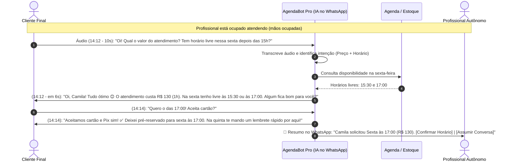

# Entregável 2: Parte Prática – Experimento Real de Validação

**Projeto:** AgendaBot Pro — Triagem e Agendamento Inteligente no WhatsApp  
**Disciplina:** Metodologias Ágeis e Validação de Produtos (FTR / Rocketseat)  
**Data da Coleta Real:** `30/10/2026` (5 profissionais reais via Google Forms)

---

## 1. Canvas de Produto (Lean Canvas e Value Proposition Canvas)

### 1.1 Lean Canvas

| Bloco do Lean Canvas | Descrição do Produto (AgendaBot Pro) |
| :--- | :--- |
| **1. Problema** | 1. Prestadores de serviço e pequenos comércios demoram de 30 min a 3h para responder clientes no WhatsApp enquanto atendem.<br>2. Perda recorrente de vendas e agendamentos no mês por demora no retorno.<br>3. Sobrecarga operacional de *"ter que fazer tudo sozinho"* (atender + agendar + checar estoque).<br>4. Rejeição dos clientes a chatbots engessados de menu numérico (*"Digite 1"*). |
| **2. Segmentos de Clientes** | **Público Investigado:** Autônomos e pequenos negócios locais que atendem via WhatsApp.<br>**Early Adopters Validados:** Profissionais de Beleza/Estética (Cabeleireiros, Manicures, Barbeiros) e Pequeno Varejo Local (recebendo de 5 a 15 mensagens/dia). |
| **3. Proposta de Valor Única (PUV)** | *"Sua secretária com IA no WhatsApp que responde em 6 segundos, ouve áudios e organiza seus agendamentos enquanto você trabalha — sem precisar configurar painéis difíceis."* |
| **4. Solução (MVP)** | 1. Assistente de IA conversacional integrado ao próprio WhatsApp.<br>2. Triagem automática de dúvidas de preços, serviços e disponibilidade.<br>3. Duas modalidades de operação: **Agendamento Automático** (preferido por Beleza) ou **Modo Aprovação Rápida em 1 Clique** (preferido por Varejo).<br>4. Configuração simplificada pelo próprio WhatsApp (zero painel complexo). |
| **5. Canais** | • Abordagem direta via WhatsApp e Instagram de profissionais locais;<br>• Indicação entre profissionais do mesmo salão/galeria comercial. |
| **6. Fontes de Receita** | • Assinatura mensal enxuta (**R$ 34,90/mês** — ajustada após validação real que apontou teto de até R$ 39/mês para autônomos de 5 a 15 mensagens/dia);<br>• Teste piloto gratuito de 7 dias. |
| **7. Estrutura de Custos** | • Consumo de tokens de LLM (baixo custo: ~5 a 15 conversas/dia = menos de R$ 2,00/mês por profissional);<br>• Infraestrutura de nuvem e integração WhatsApp. |
| **8. Métricas-Chave** | • Tempo médio de 1ª resposta (< 10 segundos);<br>• Taxa de conversão no *Smoke Test* (inscritos no piloto de 7 dias);<br>• Agendamentos/vendas recuperadas por mês;• Retenção após os 7 dias de teste. |
| **9. Vantagem Injusta** | • Onboarding "Zero-Painel": o profissional configura horários e preços mandando um simples áudio no WhatsApp, eliminando a barreira técnica. |

---

### 1.2 Value Proposition Canvas (Canvas da Proposta de Valor)

| Perfil do Cliente (Autônomo de Beleza / Pequeno Comércio) | Mapa de Valor (AgendaBot Pro) |
| :--- | :--- |
| **Tarefas do Cliente (Jobs to be Done):**<br>• Executar o serviço técnico (cabelo, unha, atendimento no balcão) com foco total;<br>• Responder dúvidas de preços, checar disponibilidade e marcar horários no WhatsApp. | **Produtos e Serviços:**<br>• Assistente de IA Generativa no WhatsApp;<br>• Agendamento automático nos horários livres;<br>• Modo "Aprovação Rápida" (1 clique). |
| **Dores (Pains):**<br>• *"Ter que fazer tudo meio que sozinha"* (fala real - U2);<br>• Cansaço de *"fazer os agendamentos"* (fala real - U5) e *"responder e verificar estoque"* (fala real - U1);<br>• Demorar de 30 min a 3h para responder e perder clientes no mês;<br>• **Medo de a ferramenta ser difícil de configurar e mexer** (U2 e U5) ou bagunçar a agenda (U1). | **Aliviadores de Dor (Pain Relievers):**<br>• Atende o cliente em segundos enquanto o profissional está ocupado;<br>• Configuração 100% guiada por conversa (sem sistemas difíceis de mexer);<br>• Opção de pedir OK com 1 clique antes de confirmar o horário quando depende de estoque/avaliação. |
| **Ganhos Desejados (Gains):**<br>• Não perder mais vendas/agendamentos durante o expediente;<br>• Economizar 1 hora por dia de digitação repetitiva;<br>• Mensalidade acessível que caiba no bolso do MEI (até R$ 39/mês). | **Criadores de Ganho (Gain Creators):**<br>• Basta recuperar 1 único atendimento no mês (R$ 40 a R$ 80) para pagar a assinatura de R$ 34,90/mês com lucro;<br>• Atendimento natural que entende áudios dos clientes. |

---

## 2. O Experimento Realizado (Demonstração Visual + Formulário Estruturado)

Para testar as hipóteses sem construir o software completo, criamos um experimento no **Google Forms** composto pela **Demonstração Visual da Conversa no WhatsApp** seguida de **10 perguntas estruturadas**.

### 2.1 Demonstração Visual Apresentada aos Usuários



**Texto exato da simulação exibida dentro do Bloco 2 do Formulário:**
```text
📱 SIMULAÇÃO DE CONVERSA NO SEU WHATSAPP:

👤 Cliente (14:12 - Áudio de 10s):
"Oi tudo bem? Queria saber o valor do atendimento e se você tem algum horário livre nessa sexta depois das 15h?"

🤖 AgendaBot Pro (14:12 - responde em 6 segundos):
"Oi, Camila! Tudo ótimo por aqui 😊 O atendimento custa R$ 130 e dura cerca de 1h. Olhei na agenda desta sexta-feira e tenho dois horários livres após as 15h: às 15:30 ou às 17:00. Algum desses fica bom para você?"

👤 Cliente (14:14):
"Quero o das 17:00! Aceita cartão?"

🤖 AgendaBot Pro (14:14):
"Aceitamos cartão e Pix sim! ✅ Prontinho, Camila: deixei pré-reservado para você nesta sexta às 17:00. Na quinta-feira te mando um lembrete rápido por aqui para confirmar sua presença, combinado?"

🔔 O QUE CHEGA PARA VOCÊ (PROFISSIONAL):
"Resumo: Camila solicitou agendamento para Sexta às 17:00 (R$ 130). [Confirmar Horário] | [Assumir Conversa]"
```

### 2.2 Perguntas do Formulário Aplicado
1. *Qual é a sua atividade ou profissão principal?*
2. *Em média, quantas mensagens de clientes (dúvidas, orçamentos ou agendamentos) você recebe por dia no WhatsApp?*
3. *Quando você está ocupado atendendo um cliente, quanto tempo em média uma mensagem nova demora para ser respondida?*
4. *Nos últimos 30 dias, você sente que deixou de fechar algum atendimento ou orçamento porque demorou para responder no WhatsApp?*
5. *Hoje, qual é a parte mais cansativa ou frustrante de atender e agendar clientes pelo WhatsApp?* (Aberta)
6. *Olhando a demonstração acima, de 1 a 5, o quanto um assistente assim ajudaria na sua rotina real?*
7. *Qual seria o seu MAIOR receio ou medo em deixar uma Inteligência Artificial responder seus clientes no WhatsApp?*
8. *Qual dessas funções seria a MAIS importante para você confiar e usar a ferramenta?*
9. *Se essa ferramenta economizasse 1 hora do seu dia e recuperasse pelo menos 2 ou 3 clientes por mês que você perderia pela demora, qual valor mensal faria sentido para você?*
10. *Estamos selecionando 5 profissionais para testar gratuitamente uma versão experimental por 7 dias. Se tiver interesse em testar sem compromisso, deixe seu Nome e WhatsApp abaixo (ou escreva "Não tenho interesse"):*

---

## 3. Validação com 5 Potenciais Usuários Reais e Evidências Coletadas

O formulário foi respondido em **`30/10/2026`** por **5 profissionais reais** de diferentes áreas de atuação: um **Varejista**, uma **Manicure**, um **Personal Trainer**, um **Publicitário** e um **Cabeleireiro**.

### 3.1 Tabela de Evidências e Dados Coletados (Exportação Real do Google Forms)

| Carimbo de data/hora | 1. Profissão Principal | 2. Mensagens por dia | 3. Tempo de espera enquanto atende | 4. Deixou de fechar nos últimos 30 dias por demora? | 5. Parte mais cansativa no WhatsApp *(Fala literal)* | 6. Nota Demo (1 a 5) | 7. Maior Receio / Medo com a IA | 8. Função Mais Importante | 9. Valor Mensal que Faria Sentido | 10. Interesse no Piloto de 7 dias (CTA) |
| :--- | :--- | :---: | :---: | :--- | :--- | :---: | :--- | :--- | :---: | :--- |
| `30/10/2026 15:39:32` | **Varejista** | Entre 5 e 15 por dia | Entre 30 min e 1 hora | **Sim, aconteceu algumas vezes no mês** | *"responder e verificar estoque"* | **5** | Medo de bagunçar minha agenda / marcar horário que eu não posso | Modo "Aprovação Rápida" (IA faz triagem e pede OK com 1 clique) | **Até R$ 39/mês** | ✅ **João Marcos Pereira** |
| `30/10/2026 15:41:24` | **manicure** | Entre 5 e 15 por dia | Entre 1 e 3 horas | **Sim, aconteceu algumas vezes no mês** | *"Ter que fazer tudo meio que sozinha"* | **4** | **Medo de ser difícil de configurar e mexer** | **Agendar automaticamente nos meus horários livres** | **Até R$ 39/mês** | ✅ **Katia de Jesus Pereira** |
| `30/10/2026 15:42:30` | **Personal trainer** | Menos de 5 por dia | Menos de 15 min (paro p/ responder) | **Raramente ou nunca acontece** | *"nenhuma"* | **3** | Medo de o cliente perceber que é robô e achar o atendimento frio | Modo "Aprovação Rápida" (IA faz triagem e pede OK com 1 clique) | **Não pagaria** (prefiro responder manualmente) | ❌ *Não tenho interesse* |
| `30/10/2026 15:45:48` | **Publicitário** | Entre 5 e 15 por dia | Entre 30 min e 1 hora | **Raramente ou nunca acontece** | *"Entender o que o cliente quer"* | **4** | *"Ser menos humana"* | Responder preços e dúvidas básicas na hora (ouvindo áudios) | **Não pagaria** (prefiro responder manualmente) | ❌ *Não tenho interesse* |
| `30/10/2026 15:47:33` | **Cabelereiro** | Entre 5 e 15 por dia | Entre 30 min e 1 hora | **Sim, aconteceu algumas vezes no mês** | *"fazer os agendamentos"* | **5** | **Medo de ser difícil de configurar e mexer** | **Agendar automaticamente nos meus horários livres** | **Até R$ 39/mês** | ✅ **Robson Aparecido de Jesus** |

*(Os dados brutos originais também estão salvos no arquivo [dados-respostas-reais.tsv](./dados-respostas-reais.tsv)).*

---

## 4. Síntese dos Principais Feedbacks e Padrões Identificados

Utilizando a IA para apoiar a tabulação e realizando a interpretação humana dos dados, extraímos **4 padrões fundamentais**:

1. **Padrão de Segmentação (Quem sente a dor converteu 100%):**
   * Existe uma linha divisória nítida entre **serviços presenciais de agendamento/comércio** (**Manicure, Cabeleireiro e Varejista — 60% da amostra**) e **serviços consultivos ou de baixa procura diária** (**Publicitário e Personal Trainer — 40% da amostra**).
   * **100% dos profissionais que perderam vendas nos últimos 30 dias (3 de 3)** deram nota 4 ou 5 para a demonstração (média **4,67/5**), aceitaram pagar até R$ 39/mês e **deixaram seu nome completo para o teste piloto de 7 dias** (*João Marcos Pereira, Katia de Jesus Pereira e Robson Aparecido de Jesus*).
   * Já os **2 profissionais que não perdem vendas por demora** (Personal Trainer e Publicitário) declararam que **não pagariam** pela ferramenta e **não têm interesse** no teste piloto.
2. **Padrão de Preço (Sensibilidade unânime ao teto de R$ 39/mês):**
   * Entre os 3 profissionais dispostos a pagar, **100% escolheram a opção "Até R$ 39/mês"**.
   * Nenhum respondente marcou as faixas de *"Entre R$ 49 e R$ 79/mês"* ou *"Até R$ 97/mês"*. Como 80% da amostra recebe um volume moderado de mensagens (*"Entre 5 e 15 por dia"*), valores acima de R$ 49/mês são percebidos como caros para o porte do negócio.
3. **Padrão de Usabilidade no Setor de Beleza (Medo da complexidade técnica):**
   * A **Manicure (Katia)** e o **Cabeleireiro (Robson)** apresentaram comportamento idêntico: ambos sofrem com o trabalho operacional solitário (*"Ter que fazer tudo meio que sozinha"* / *"fazer os agendamentos"*), ambos querem que a IA **agende automaticamente nos horários livres**, e ambos apontaram o mesmo receio número 1: **"Medo de ser difícil de configurar e mexer"**.
4. **Padrão de Controle no Comércio/Varejo:**
   * O **Varejista (João Marcos)** sofre com *"responder e verificar estoque"*. Por depender de conferência física, seu maior medo é a IA *"bagunçar minha agenda / marcar horário que eu não posso"*, preferindo o **Modo "Aprovação Rápida" (1 clique)**.

---

## 5. Comparação entre Hipótese Inicial e Resultados Encontrados

| Hipótese Avaliada | O que Esperávamos (Hipótese Inicial) | O que Encontramos na Prática (Evidências Reais) | Conclusão |
| :--- | :--- | :--- | :---: |
| **Hipótese de Problema (HP)** | $\ge 60\text{–}80\%$ dos autônomos demoram >30 min para responder no WhatsApp e perdem clientes no mês. | **60% (3/5)** demoram de 30 min a 3h e **perdem clientes algumas vezes no mês** (Manicure, Cabeleireiro e Varejista). Porém, Personal Trainer (<5 msgs/dia, responde em <15m) e Publicitário (foco criativo/briefing) **não sofrem com essa dor**. | ✅ **Validada no nicho de Beleza e Varejo** (Descartada para Personal/Publicitário) |
| **Hipótese de Solução – Aderência (HS1)** | $\ge 60\%$ avaliariam a Demonstração Visual com nota $\ge 4$ (de 5). | **80% (4/5)** deram nota **4 ou 5** (notas: 5, 4, 3, 4, 5 — **Média geral: 4,2/5** e **4,67/5** no público pagante). | ✅ **Confirmada** |
| **Hipótese de Solução – Objeções (HS2)** | Imaginávamos que o principal medo dos compradores seria a IA errar respostas ou parecer robô. | **Contrariada no público comprador:** Quem falou em "parecer robô / ser menos humana" foram justamente os que **não compram** (Personal e Publicitário). Para os compradores de Beleza (Manicure e Cabeleireiro), o maior medo real é **ser difícil de configurar e mexer**! | 🔄 **Hipótese Contrariada (Gerou aprendizado crucial de UX)** |
| **Hipótese de Valor – Preço (HV1)** | $\ge 60\%$ pagariam entre **R$ 49 e R$ 97/mês**. | **Contrariada no valor do ticket:** 60% (3/5) pagariam pela solução, mas **100% dos pagantes escolheram "Até R$ 39/mês"**. Ninguém aceitou pagar R$ 49–R$ 97/mês. | ❌ **Ticket de R$ 49–97 Refutado (Teto real validado: até R$ 39/mês)** |
| **Hipótese de Valor – Comprometimento (HV2)** | $\ge 60\%$ (3/5) deixariam nome/contato para testar o piloto de 7 dias. | **60% (3/5)** se inscreveram deixando seus nomes reais (*João Marcos Pereira, Katia de Jesus Pereira e Robson Aparecido de Jesus*). | ✅ **Confirmada** |

---

## 6. Decisão Final Justificada: **AJUSTAR (ITERAR)**

### 6.1 Decisão Tomada
Diante das evidências empíricas coletadas com os 5 usuários reais, a decisão estratégica do time de Produto é: **AJUSTAR (Iterar antes de desenvolver o MVP)**.

### 6.2 Justificativa da Decisão
* **Por que NÃO Abandonar ou Pivotar radicalmente?**
  Porque o problema central e o interesse na solução foram comprovados na prática: **60% dos respondentes** (e **100% dentro do recorte de Beleza e Varejo**) perdem vendas mensalmente pela demora no WhatsApp, deram nota média de **4,67 de 5** para a demonstração visual, estão dispostos a pagar mensalmente e **se inscreveram voluntariamente no teste piloto de 7 dias**.
* **Por que AJUSTAR em vez de Perseverar no plano original sem alterações?**
  Porque o experimento revelou **três erros na nossa concepção original** que teriam causado o fracasso do produto caso tivéssemos partido direto para o desenvolvimento de software:
  1. **Ajuste de Preço (De R$ 49–97 para R$ 34,90/mês):** Descobrimos que o público-alvo recebe de 5 a 15 mensagens/dia e só aceita pagar **até R$ 39/mês**. Como 15 mensagens/dia geram um custo de API de IA inferior a R$ 2,00/mês por profissional, ajustar a assinatura para **R$ 34,90/mês** mantém altíssima margem para a startup e remove a barreira de entrada do cliente.
  2. **Ajuste de Usabilidade (Onboarding "Zero Configuração" via Áudio no WhatsApp):** Descobrimos que o maior medo da Manicure e do Cabeleireiro é *"ser difícil de configurar e mexer"*. Em vez de construir um painel web complexo onde o profissional precisa cadastrar tabelas e horários manualmente, o próprio assistente de IA fará a configuração conversando com o profissional no WhatsApp.
  3. **Ajuste de Nicho (Foco em Beleza/Estética e Comércio Local):** Excluímos profissionais liberais consultivos (Publicitários) e profissionais com carteira mensal fixa e baixo volume diário de leads (Personal Trainers), concentrando o produto onde a dor de agendamento e resposta rápida é diária.

### 6.3 Próximo Passo Recomendado
Executar o **MVP Concierge / Mágico de Oz de 7 dias** diretamente no WhatsApp dos 3 profissionais inscritos (**João Marcos Pereira, Katia de Jesus Pereira e Robson Aparecido de Jesus**), medindo quantos agendamentos reais são realizados na semana e se a configuração via conversa elimina o receio de dificuldade técnica.
