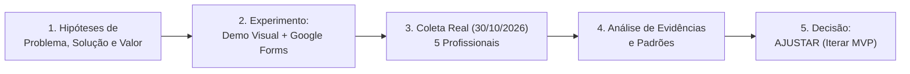

# 🚀 Case de Product Discovery: AgendaBot Pro

> **Da Hipótese à Evidência: Validando um Produto Digital com IA e Métodos Ágeis**  
> **Disciplina:** Metodologias Ágeis e Validação de Produtos (Rocketseat / FTR)  
> **Status do Discovery:** Concluído com 5 Usuários Reais (`30/10/2026`) | **Decisão Final:** 🔄 **AJUSTAR (Iterar)**  

---

## 📌 Resumo Executivo

Profissionais autônomos e pequenos comércios locais utilizam o WhatsApp como principal canal de vendas e agendamento, mas **não conseguem responder clientes imediatamente enquanto estão atendendo**. Isso gera perda de vendas/agendamentos no mês e sobrecarga operacional por terem que fazer tudo sozinhos.

Antes de investir semanas desenvolvendo um software completo de agendamento com IA, aplicamos **Lean Startup, Product Discovery e experimentação rápida** com **5 profissionais reais** (via Google Forms + Demonstração Visual da Solução) para responder a uma única pergunta: **este produto merece ser desenvolvido?**

---

## 📂 Entregáveis Oficiais do Trabalho

* 🖥️ **[Apresentação Interativa de Slides (Abrir Online no GitHub Pages)](https://barbatov.github.io/agendabot-pro/)** *(arquivo fonte: [apresentacao-slides.html](./apresentacao-slides.html))* — Apresentação completa do case com 8 slides, simulação visual do WhatsApp, tabela de evidências reais e decisão estratégica.
* 📘 **[ENTREGA-1-Parte-Teorica.md](./ENTREGA-1-Parte-Teorica.md)** — **Entregável 1 Completo:** Problema, público e oportunidade; hipóteses de problema, solução e valor; solução inicial e definição do MVP; como a IA foi utilizada no Discovery; experimento escolhido e critérios de sucesso; e matriz prévia de decisão.
* 📗 **[ENTREGA-2-Parte-Pratica.md](./ENTREGA-2-Parte-Pratica.md)** — **Entregável 2 Completo (Unificado):** Lean Canvas e Value Proposition Canvas; protótipo/demonstração visual + formulário; validação com 5 usuários reais; evidências e dados coletados; síntese dos feedbacks e padrões; comparação hipótese inicial vs. resultados; e decisão final justificada.
* 📙 **[DOCUMENTO-UNICO-COMPLETO.md](./DOCUMENTO-UNICO-COMPLETO.md)** — **Versão Unificada (Entregáveis 1 + 2 juntos):** Documento consolidado contendo toda a parte teórica e prática em um único arquivo.
* 📊 **[dados-respostas-reais.tsv](./dados-respostas-reais.tsv)** — Planilha bruta exportada do Google Forms com os carimbos de data/hora (`30/10/2026`) e respostas dos 5 participantes.
* ⚙️ **[gerar_google_forms.gs](./gerar_google_forms.gs)** e **[gerar_google_slides.gs](./gerar_google_slides.gs)** — Scripts de automação (Google Apps Script) criados para publicar o formulário de pesquisa e os slides.

---

## 1. O Problema e o Público-Alvo

* **Problema:** Prestadores de serviço com hora marcada e pequenos varejistas ficam com as mãos ocupadas durante o atendimento e demoram de **30 minutos a 3 horas** para responder novos contatos no WhatsApp. Com isso, deixam de fechar atendimentos/orçamentos algumas vezes no mês e sofrem com o desgaste de gerenciar agenda e estoque sozinhos.
* **Público-Alvo Investigado:** Autônomos e pequenos negócios locais que utilizam o WhatsApp diariamente (validado com Varejista, Manicure, Personal Trainer, Publicitário e Cabeleireiro).

---

## 2. Hipóteses Testadas

1. **Hipótese de Problema (HP):** $\ge 60\text{–}80\%$ dos profissionais autônomos demoram mais de 30 minutos para responder no WhatsApp enquanto atendem e perdem clientes no mês por essa demora.
2. **Hipótese de Solução (HS):** Um assistente de IA conversacional no WhatsApp capaz de ouvir áudios, responder preços e agendar horários automaticamente terá alta aprovação (nota $\ge 4/5$ em pelo menos $60\%$ da amostra).
3. **Hipótese de Valor e Preço (HV):** Pelo menos $60\%$ dos entrevistados demonstrarão disposição a pagar entre **R$ 49 e R$ 97/mês** e deixarão seu contato pessoal para participar de um teste piloto gratuito de 7 dias.

---

## 3. O Experimento (MVP de Validação)

Em vez de construir o código completo da plataforma, executamos um experimento enxuto de **Concept Testing + Smoke Test** combinando:
1. **Demonstração Visual Realista:** Simulação de uma conversa real de WhatsApp onde a cliente envia um áudio perguntando preço e horário para sexta-feira, a IA responde naturalmente em 6 segundos, consulta os horários livres e envia um resumo estruturado para o profissional.
2. **Formulário Estruturado de Discovery (10 perguntas no Google Forms):** Dividido em diagnóstico do comportamento passado (*Mom Test*), reação à demonstração visual (objeções e prioridades) e teste de comprometimento (preço + inscrição no piloto).

---

## 4. Evidências Reais e Resultados Obtidos (5 Usuários)

Entrevistamos 5 profissionais reais em `30/10/2026`: **Varejista (João Marcos Pereira), Manicure (Katia de Jesus Pereira), Personal Trainer (Anônimo), Publicitário (Anônimo) e Cabeleireiro (Robson Aparecido de Jesus)**.

| Métrica / Critério | Meta Prévia | Resultado Real Obtido | Status |
| :--- | :---: | :---: | :---: |
| **Demoram > 30 min e perdem clientes no mês** | $\ge 60\text{–}80\%$ | **60% (3/5)** perdem clientes no mês (Manicure, Cabeleireiro e Varejista). Personal e Publicitário não perdem. | ✅ Validado (com recorte de nicho) |
| **Aprovação da Demonstração Visual (Nota $\ge 4$ de 5)** | $\ge 60\%$ (3/5) | **80% (4/5)** deram nota 4 ou 5 (**Média geral: 4,2/5**; Média nos interessados: **4,67/5**) | ✅ Atingido |
| **Disposição a pagar pela ferramenta** | $\ge 60\%$ a R$ 49–97 | **60% (3/5)** pagariam, **MAS 100% deles escolheram "Até R$ 39/mês"** | 🔄 Preço Ajustado |
| **Conversão no Call-to-Action (Inscritos no Piloto)** | $\ge 60\%$ (3/5) | **60% (3/5)** deixaram o nome para o teste de 7 dias (*João Marcos, Katia e Robson*) | ✅ Atingido |

---

## 5. Principais Aprendizados (O que os dados reais revelaram)

1. **Onde a dor realmente existe (Beleza e Comércio Local vs. Serviços Consultivos):**
   * **100% dos profissionais de Beleza (Manicure Katia e Cabeleireiro Robson) e Varejo (João Marcos)** confirmaram perder vendas no mês por demorarem de 30 min a 3h para responder, avaliaram a demo com notas 4 e 5, aceitaram pagar e se inscreveram no piloto.
   * Já o **Personal Trainer** (que recebe menos de 5 mensagens/dia e responde em menos de 15 min) e o **Publicitário** (cujo trabalho exige briefing criativo humano: *"Entender o que o cliente quer"*) não perdem clientes por demora e não têm interesse na ferramenta.
2. **Descoberta Crítica de Preço (Evitamos um erro fatal de lançamento):**
   * Nossa hipótese inicial previa cobrar entre **R$ 49 e R$ 97/mês**. Na prática, como esses autônomos recebem um volume moderado (**5 a 15 mensagens/dia**), **todos os 3 interessados escolheram a faixa de "Até R$ 39/mês"**.
3. **O maior medo do público comprador NÃO é a IA errar — é ser difícil de configurar!**
   * Enquanto nós imaginávamos que os profissionais de beleza teriam medo de deixar a IA agendar sozinha, tanto a **Manicure (Katia)** quanto o **Cabeleireiro (Robson)** escolheram **"Agendar automaticamente nos meus horários livres"** como função principal, mas apontaram o **"Medo de ser difícil de configurar e mexer"** como sua maior barreira.
   * Já no **Varejo (João Marcos)**, onde a dor é *"responder e verificar estoque"*, o profissional preferiu o **Modo "Aprovação Rápida" (1 clique)** para não correr risco de prometer algo fora de estoque/horário.

---

## 6. Decisão Final e Próximos Passos

### 🔄 Decisão: **AJUSTAR (Iterar antes de construir)**

Com base nas evidências reais, decidimos **AJUSTAR** a estratégia em 3 pontos antes de construir o MVP:

1. **Ajuste de Público-Alvo (Foco em Beleza/Estética e Comércio Local):** Direcionar o produto para Cabeleireiros, Manicures, Barbeiros e pequenos lojistas, descartando profissionais liberais consultivos (Publicitários) ou de baixa rotatividade diária (Personal Trainers).
2. **Ajuste de Preço (Plano Autônomo até R$ 39/mês):** Como o volume real de atendimento é de 5 a 15 conversas/dia (o que consome menos de R$ 2,00/mês em API de LLM por profissional), reduzimos o preço planejado de R$ 69–97 para **R$ 34,90/mês**, alinhado à disposição a pagar comprovada em campo.
3. **Ajuste de Produto (Configuração "Zero-Painel" no próprio WhatsApp):** Para eliminar o medo número 1 dos profissionais de beleza (*"ser difícil de configurar e mexer"*), o MVP não terá um painel administrativo complexo: o profissional configurará seus horários e preços apenas mandando um áudio no próprio WhatsApp.
4. **Próximo Passo Recomendado:** Rodar o teste piloto Concierge de 7 dias com os 3 profissionais reais inscritos (**João Marcos Pereira, Katia de Jesus Pereira e Robson Aparecido de Jesus**).
